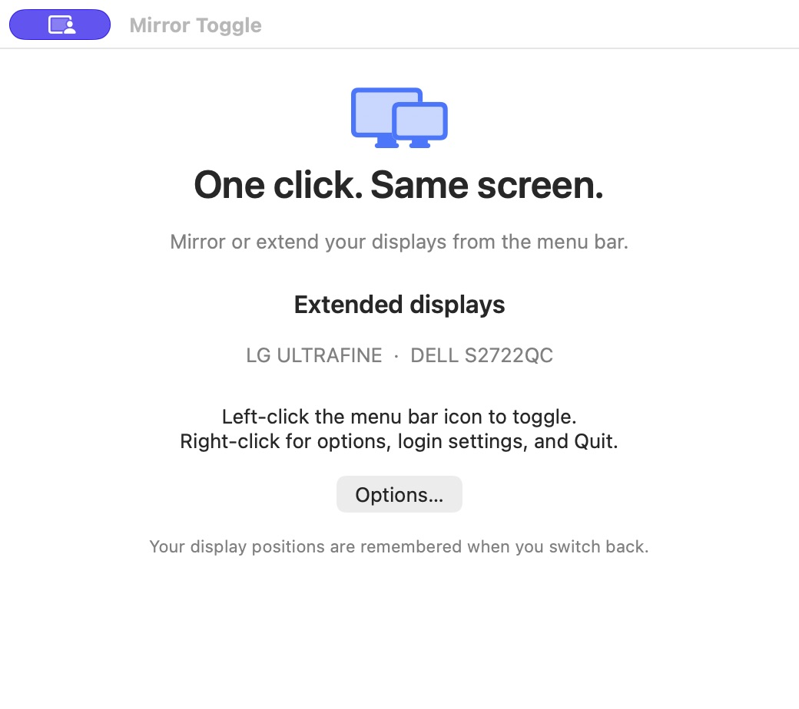
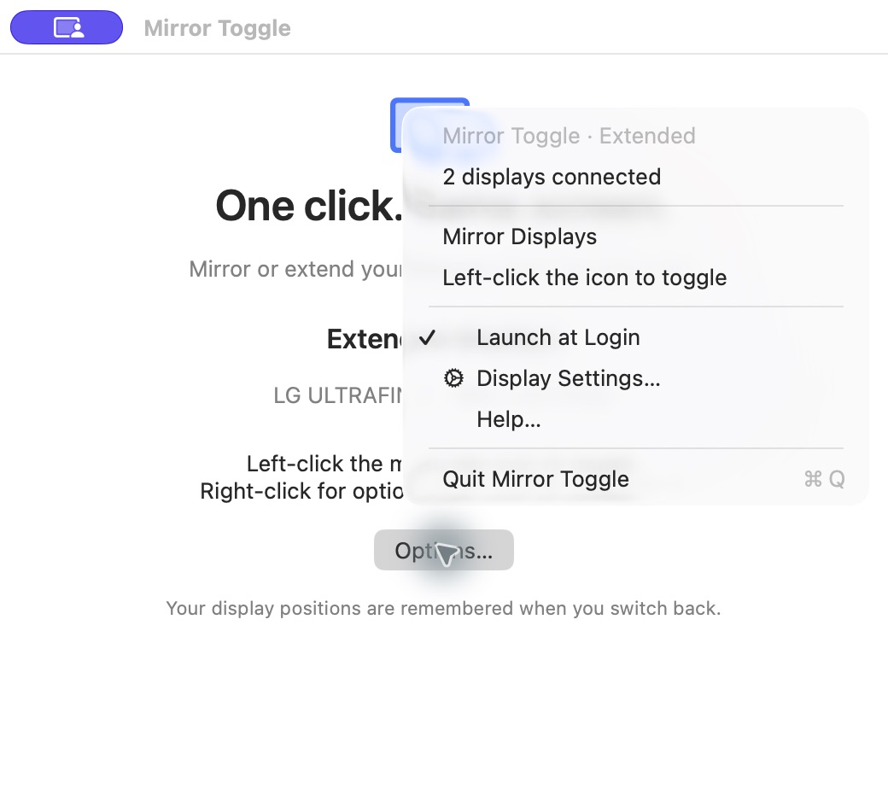

# Mirror Toggle

A small, local menu bar app for Apple silicon Macs running macOS 13 or later.

**Left-click to mirror or extend. Right-click for options.** Uses Apple's Core Graphics display APIs directly, with no background service or command-line dependency.

## Screenshots





Captured from the running app on macOS. The Help window's Options button opens the same menu as right-clicking the menu bar icon.

## Install and use

Download the app from [Releases](https://github.com/xieweizhi/mirror-toggle/releases/latest), then unzip it.

1. Drag **Mirror Toggle.app** to Applications.
2. Open it. A two-display icon appears in the menu bar. There is no Dock icon.
3. **Left-click** the icon to switch between mirroring and extended displays.
4. **Right-click** (or Control-click) for options, Launch at Login, Display Settings, and Quit.
5. Select **Help…** to see the connected displays and usage instructions.

The tooltip shows the current state. Mirroring uses the current main display as the source and includes all connected displays. With the same monitors connected, switching back restores their saved positions. If no layout has been saved or the monitors changed, displays are arranged horizontally. Display changes last for the current login session. The app does not toggle displays when launched.

Launch at Login is optional; enable it after moving the app to Applications. macOS may require allowing the login item in System Settings → General → Login Items.

This build is locally ad-hoc signed, not notarized for public distribution. No Accessibility or Screen Recording permission is requested. Display hardware and drivers determine whether mirroring is supported. A brief display blackout during switching is normal.

## Rebuild

Source is included. With Apple command line developer tools installed, run `zsh Source/build.sh` from this folder. The app is built for Apple silicon.

## Verification

```sh
"./Mirror Toggle.app/Contents/MacOS/MirrorToggle" --self-test
"./Mirror Toggle.app/Contents/MacOS/MirrorToggle" --diagnose
```

The self-test checks saved-layout matching and persistence. Diagnostics report connected monitors without changing the display configuration.

Live mirror switching must be checked on your monitors; diagnostics and self-tests do not prove that the display driver will accept a change.
